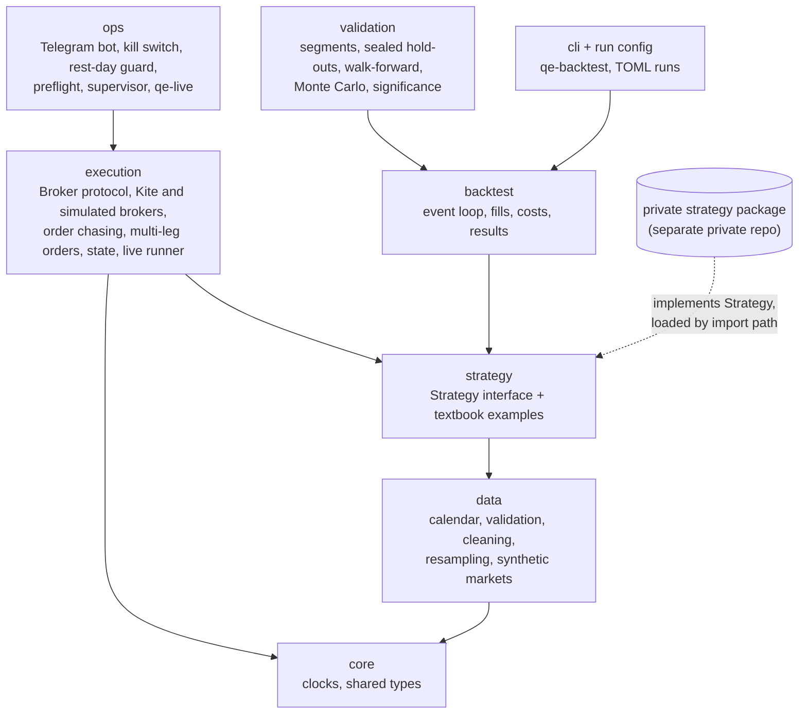

# Architecture

## Design goals

1. **One code path from research to live.** The strategy object a backtest runs is the same object
   the live trader runs. Differences between backtest and live are confined to two seams: the
   clock and the broker.
2. **No look-ahead by construction.** Every bar carries the moment it became knowable
   (`available_at`); the engine never hands a strategy a bar before that moment.
3. **Deterministic and testable.** Time comes from an injected `Clock`, randomness from a seeded
   `numpy.random.Generator`, orders go to a `Broker` protocol with a fake implementation. A full
   trading day replays in milliseconds in a unit test.
4. **Fail safe.** When the system cannot be sure, it takes the action whose worst case is cheaper,
   and the code says which way that is and why.
5. **Strategies are plug-ins.** The engine knows nothing about any particular signal. Concrete
   strategies are loaded by import path from configuration and can live in another repository.

## Layers

**Dependency rule:** a layer imports only from layers below it. `strategy` never imports
`execution`, so a strategy cannot tell (and cannot behave differently) whether it is in a backtest
or live. `execution` never imports a concrete strategy.

## Data contract

- Bars are a `pandas.DataFrame` with lowercase `open, high, low, close, volume` columns and a
  timezone-aware index in IST, each row labelled by the **start** of its interval.
- Resampled bars add `available_at` (the end of the interval: the earliest moment a decision may
  use the bar), `bars` (how many source bars went in) and `complete`.
- Bars are resampled on **session-anchored** bins: a 15-minute series starts at the session open,
  not at the top of the hour. Pandas' default clock-anchored bins silently produce bars that no
  exchange-aware trader would recognise.
- **Repair by blanking, never by inventing prices.** A bad bar becomes `NaN`, so any calculation
  that touches it fails loudly instead of trading on a made-up number.

### Data hazards the engine checks for

These all appeared in real vendor data; each has a detector in `quant_engine.data.quality`.

| Hazard | What it looks like | Why it matters |
| --- | --- | --- |
| Frozen bars | A run of identical, flat bars, then one print | Since a 2026 exchange change, index minute series show a frozen stretch before the closing-auction print. A stop or signal evaluated on frozen bars sees a market that was not there. |
| Carried bars | Flat, zero-volume option bars at an old price (sometimes another strike's) | Vendors fill untraded minutes with the last price. A backtest that fills at those prices trades at prices nobody could trade at. Deep in-the-money strikes are the worst affected. |
| Missing minutes | Gaps inside the session | Resampled bars built from partial data look complete unless counted. |
| Late holidays | A weekday with no data that is not in the holiday list | Calendars are inputs that go stale; the code treats them as such. |

## Strategy plug-ins

A strategy subclasses `Strategy` and implements `on_bar(bar, ctx)`; `on_start`, `on_fill` and
`on_finish` are optional. Everything it may know or do goes through the `StrategyContext`
protocol: `now`, `position`, `working_orders`, `is_session_end`, `history(n)`, `submit`, `cancel`.
The backtester and the live runner both implement that protocol, so the
strategy code that is tested is the code that trades.

Strategies are loaded by import path (`package.module:ClassName`) from a TOML run file. Private
strategy code is installed as its own package and named only in a config file that stays with it.
This repository ships only a textbook moving-average crossover.

## Backtest

`Backtester(strategy, BacktestConfig).run(bars)` walks the bars in time order. Per bar: match the
working orders placed before it, let the strategy see the completed bar, handle the session end
(cancel DAY orders; close the position for intraday books), mark equity at the close. A position
still open after the last bar is closed at the last close and tagged `end of data`.

The fill model resolves what a bar cannot tell (the path inside it) against the strategy:

| Situation | Assumption |
| --- | --- |
| Order placed on bar *t* | Can fill from bar *t + 1*, never on *t* |
| Market order | Next open, plus slippage |
| Stop the bar opens through | Fills at the open, not the trigger |
| Limit order | Must trade through its price by a tick; touching is not a fill |
| Stop and limit both reachable in one bar | The stop hit first |
| Protective stop placed on an entry fill | Can be hit in the rest of the entry bar |
| Limit placed on an entry fill | Waits for the next bar |

Charges are a separate `CostModel`: a flat basis-point model, or a `ChargeSchedule` of brokerage,
STT, exchange charge, SEBI fee, stamp duty and GST with dated presets. The `Ledger` books round
trips from flat to flat (adds and partial exits included, a reversal split into two trades with its
charge apportioned) so every unit traded appears in exactly one trade.

## Research protocol

The validation layer (`quant_engine.validation`) encodes a research discipline, not only a set of
statistics. `examples/research_protocol.py` runs all of it on a synthetic market, and
[`research/`](../research/README.md) is the log of real ideas put through it.

- **Chronological segments.** History is cut into segments. Ideas are tuned on some; the rest stay
  sealed.
- **Pre-registration.** Before a sealed segment is opened, the exact code and parameters are hashed
  (SHA-256) and written to a registry together with a pass/fail bar fixed in advance. The run refuses
  to start if a hash has changed since registration.
- **Spent segments.** Once a sealed segment has been opened for a family of ideas it is marked spent
  for that family. Re-tuning after seeing it and testing on it again is the most common way a
  backtest lies; the registry makes it impossible to do by accident.
- **Luck tests.** A best-of-N result is compared with the best-of-N of random or permuted
  strategies; Sharpe ratios are deflated for the number of trials; families of tests get a Holm
  correction.
- **Monte Carlo.** Trade sequences are resampled (independent and block bootstrap) to get
  distributions of drawdown, losing streaks and risk of ruin, not single numbers.
- **Walk-forward.** Anchored and rolling walk-forward for parameter stability.
- **Real prices over models.** Option results are priced on recorded premiums wherever the data
  exists; a model price is labelled as such.

## Execution

- A `Broker` protocol with two implementations: `KiteBroker` (Zerodha Kite Connect, given an
  already-authenticated client, so it never handles credentials) and `SimulatedBroker`, which fills
  against any quote source: live Kite quotes for paper trading, hand-set quotes for tests. The
  simulator can inject the failures real brokers produce: rejections, outages, and timeouts after
  the order was accepted.
- Broker errors are split by what the caller must do next: `OrderRejected` (nothing happened),
  `BrokerUnavailable` (nothing happened, retry), `OutcomeUnknown` (look before retrying).
- Requests are spaced to stay inside the broker's rate limits (`RateLimiter`, on the injected clock).
- Limit orders are chased with capped re-pricing instead of sent as market orders.
- **Idempotent placement.** If a placement call times out, the engine looks for the order before
  placing again. A lost response must never become a double position.
- **Multi-leg orders** run in a configurable leg order (protective legs first by default) and roll
  back the legs already filled when a later leg fails.
- State is written atomically after every transition. On restart the engine reconciles its state
  with the broker's positions before it does anything else.
- A broker-side protective order backs up every engine-managed stop, so a crashed process still
  leaves the position protected. If that order ever fills, the book picks the fill up on its next
  poll and tells the strategy.
- `LiveRunner` is the live `StrategyContext`: the same strategy object as in the backtest, fed by a
  `BarFeed` (Kite minute candles resampled on the session grid, or a replay of prepared bars for
  rehearsals). Market and stop orders are supported live; limit orders are refused rather than
  half-implemented.

## Operations

- A Telegram bot for status, per-book stop, skip-a-day and takeover (hand a position to manual
  control).
- **Dated kill switch.** A stop file counts only on the day it was made. A stale file from last week
  must not block today, and today's must not be mistaken for an old one.
- **Holiday guard with a stated safe direction.** Starting a book on a holiday costs a few needless
  messages. Not starting it on a trading day could leave an open position unmanaged. So when the
  guard cannot be sure, it runs.
- **Preflight checks** before the session: access token valid, registered static IP (an exchange
  requirement for API orders), funds, instrument master loaded, and exchange rule drift (lot sizes,
  tick sizes, expiry weekdays).
- A **supervisor** runs each book for one session: it checks the kill switch before every poll,
  counts errors in a row and closes the book after too many, and stops without trading when the book
  no longer knows what the broker holds.
- `qe-live` wires a book from a TOML file. It is **paper by default**; real orders need `--live` on
  the command line, so a copied config file can never trade money by accident.
- Deployment on a Linux VM: systemd for the bot, cron for the daily books, one log per book per day
  (`deploy/`).

## Keeping private code private

- This repository has its own history. No private code has ever been committed to it.
- `qe-leak-guard` scans the tree for secrets (API keys, bot tokens, private keys, public IP
  addresses) in CI.
- Locally, git hooks run the same guard with a private word list kept outside the repository, on
  every commit and on every commit message.

## Roadmap

| Milestone | Contents | Status |
| --- | --- | --- |
| M1 | Clock, data layer (calendar, validation, quality checks, resampling, synthetic market), leak guard | Done |
| M2 | Strategy interface and loader, event-driven backtest, fill model, charge schedules, ledger, metrics, TOML runs and `qe-backtest` | Done |
| M3 | Validation: segments, hold-out registry, walk-forward, Monte Carlo, significance tests | Done |
| M4 | Execution: Broker protocol, simulated and Kite brokers, order chasing, multi-leg orders, state, live runner | Done |
| M5 | Operations: Telegram bot, kill switch, rest-day guard, preflight, supervisor, `qe-live`, deployment files | Done |
| M6 | Research log: ideas tested and closed - my own and ones from books, courses and other traders, credited - each with its protocol and result | Done |
